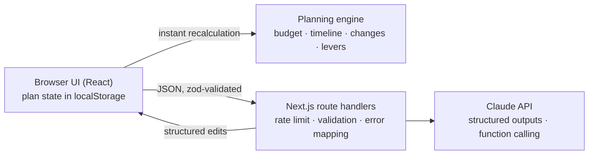

# ShaadiSaathi: a GenAI wedding planning assistant

[](https://github.com/apoorvgpt9/shaadi-saathi/actions/workflows/ci.yml)

ShaadiSaathi helps an Indian family organise their wedding: the **budget**, the **timeline**, **vendor checklists** and **personalized ideas** for every function (haldi, mehendi, sangeet, wedding, reception). It is built for execution, not inspiration. It asks before it assumes, shows the consequences of every decision, is honest about which numbers are estimates, and revises the plan when life changes.

**Live demo:** <https://shaadi-saathi-omega.vercel.app>

**Demo video (2:40):** <https://youtu.be/2veA-6XN5CU>

## The problem

Planning a wedding is not one problem. It is many connected ones. When the guest count changes, catering changes. When the date moves, the bookings that depend on it get urgent. When the budget shrinks, the family has to decide what matters most. A generic chatbot can list "10 wedding ideas", but it cannot keep a real plan consistent with a family's budget, deadlines and priorities.

ShaadiSaathi keeps that plan, and uses GenAI where it adds real value: understanding the family, turning plain-language changes into structured edits, personalizing ideas and checklists, and reading vendor quotes.

## What it does

| Need | How ShaadiSaathi handles it |
|---|---|
| **Understand the family first** | A short conversation (English or Hinglish) asks 1–2 questions at a time. A live "What I've understood" panel shows the date, city, guests, budget, functions, priorities and notes as they are captured. Nothing is planned until the essentials are known. |
| **Budget** | Each category (venue, catering, decor, photography, attire, makeup, entertainment, rituals, invitations, transport, contingency) is estimated bottom-up from guests per function, city tier and style. Every line shows its basis and an **Estimate / Quoted / Confirmed** badge. You can override any line, and the totals update instantly. |
| **Timeline** | 27 planning tasks with lead times and dependencies, scheduled back from each function's date. Overdue tasks, including delayed ones whose new date has passed, become **Urgent, this week**. Delaying a task pushes its dependents and flags them **At risk**, or **Clash** if they run into the function. "Next 3 things to do" always shows what is actionable now. |
| **Vendor checklists** | A personalized checklist per vendor category: what you need, questions to ask, and what to confirm before paying an advance. **Paste a quote** and the AI extracts the total, guests covered, inclusions, extra charges and open questions. Then **compare quotes** side by side against the budget estimate. |
| **Personalized ideas** | Three ideas per function, each marked as saving money, staying within budget or adding cost, and tied to *this* family (ages, culture, accessibility, priorities). Feedback such as "too expensive" or "suitable for kids and elders" regenerates them. |
| **Adapting to change** | Type "50 more guests, budget is now 7 lakh, wedding two weeks earlier". The AI turns it into structured changes with function calling, the plan is recomputed, and a **What changed** summary shows the money and task impact. Then you choose **Accept** or **Undo**. |
| **Trade-offs, not blanket cuts** | When over budget, the app computes concrete levers (trim a function's guests, step one category down, skip a minor function) with exact savings. The AI proposes up to three bundles that protect the family's top priorities. Nothing changes until the family picks one. |

## How GenAI is used, and where it is deliberately not

All money and dates are computed by a **deterministic, tested planning engine** (`src/lib/plan/`). Claude never produces a rupee amount used in calculations. Its only job with numbers is reading them from a quote the user pasted. This keeps estimates honest and the plan consistent.

| Route | What Claude does | Technique |
|---|---|---|
| `POST /api/intake` | Runs the conversation and extracts a structured profile every turn | Structured output (zod schema) |
| `POST /api/change` | Turns a plain-language change into plan edits, or asks one clarifying question | **Function calling**: 10 strict tools, one per edit type |
| `POST /api/tradeoffs` | Chooses and explains trade-off bundles from engine-computed levers | Structured output, ids validated against the engine |
| `POST /api/vendors` | Writes vendor checklists for this family | Structured output |
| `POST /api/ideas` | Writes ideas per function, and refines them from feedback | Structured output |
| `POST /api/quote` | Extracts facts from a pasted vendor quote | Structured output, with the quote treated as untrusted data |

Each route sends one Claude request: adaptive thinking, effort tuned per route, and server-side refusal fallback. Every response is re-validated with zod before it reaches the browser. The structured-output routes repeat the request once, only when the output is malformed, and invalid tool calls from `/api/change` are dropped. The model is configurable per route through environment variables.

## Architecture



- **The engine runs in the browser**, so budget edits, task updates and "what if" checks are instant and work even when the AI is unavailable.
- **AI routes are stateless.** The client sends only what each call needs, and the server stores nothing.
- **Shared contract:** `src/lib/schemas/` (re-exported by `src/lib/types.ts`) defines every stored and transported shape once, as zod schemas. The engine imports only these schemas; see [docs/ARCHITECTURE.md](docs/ARCHITECTURE.md) for the layers, algorithms and AI request lifecycle.

```
src/lib/schemas/      shared zod contract (limits, domain, plan, views, api); src/lib/types.ts re-exports it
src/lib/plan/         deterministic engine (benchmarks, budget, timeline, changes, summary, edits, levers, options, profile)
src/lib/store.ts      client state: reducer, pending changes, validated localStorage parsing
src/lib/api.ts        typed client for the AI routes
src/lib/ai/           Claude client, prompts, tools, shared route handler
src/app/api/*/        six AI route handlers + health check
src/components/       UI (intake, workspace, tabs, change summary, trade-offs)
tests/                engine, route, store and API tests (node); tests/ui/ for components with axe (jsdom)
docs/                 ARCHITECTURE, TESTING, ACCESSIBILITY
scripts/smoke.mjs     optional end-to-end check against a running server with a real key
```

## Try it

Press **Try an example** on the first screen. It sends an example scenario as a real message: a Jaipur wedding about four months away, 200 guests, ₹8 lakh, with a mehendi the day before. Then:

1. **Build my plan.** The estimate comes to about ₹9.6L, roughly 20% over, and the urgent bookings are flagged.
2. In **What changed?**, type: *50 more guests, budget down to 7 lakh, wedding two weeks earlier*. Review the summary, then Accept.
3. **Help me get back under budget.** Pick one of the options and see the engine-computed saving.
4. **Vendors:** paste a caterer's quote and compare it against the estimate.
5. **Timeline:** mark "Shortlist and book venue(s)" as delayed and watch its dependents get flagged.

## Running locally

Requires Node.js 20+ and an Anthropic API key.

```bash
npm install
cp .env.example .env.local   # then set ANTHROPIC_API_KEY
npm run dev                  # http://localhost:3000
```

| Variable | Purpose |
|---|---|
| `ANTHROPIC_API_KEY` | Required. Server-side only. |
| `ANTHROPIC_MODEL` | Optional default model (default `claude-opus-5-5`) |
| `ANTHROPIC_MODEL_<ROUTE>` | Optional per-route override, e.g. `ANTHROPIC_MODEL_INTAKE` |

```bash
npm test              # engine, route, store, API client and component tests (no network; Claude is mocked)
npm run check         # everything CI runs before the build: format, lint, typecheck, tests with coverage gate
npm run build
node scripts/smoke.mjs http://localhost:3000   # optional: real end-to-end calls against a running server
```

## Quality gates

`npm run check` runs the first four rows in order; CI runs it, then the build and the audit. Details: [docs/TESTING.md](docs/TESTING.md), [docs/ACCESSIBILITY.md](docs/ACCESSIBILITY.md), [CONTRIBUTING.md](CONTRIBUTING.md).

| Command | What it enforces | Threshold or flag |
|---|---|---|
| `npm run format:check` | Prettier over `src`, `tests`, `scripts` and root `*.ts`/`*.mjs` | print width 120 |
| `npm run lint` | typescript-eslint `strictTypeChecked` and `stylisticTypeChecked`, `jsx-a11y`, `react-hooks`, Next.js core web vitals | any finding fails |
| `npm run typecheck` | `next typegen && tsc --noEmit` | `strict`, `noUncheckedIndexedAccess`, `noUnusedLocals`, `noUnusedParameters`, `noImplicitReturns`, `noFallthroughCasesInSwitch` |
| `npm run test:coverage` | Vitest over `src/**` (node and jsdom projects, axe checks in the UI suite) | statements 99%, branches 96%, functions 99%, lines 99% (`vitest.config.ts`) |
| `npm run build` | Production build | build errors fail |
| `npm audit --omit=dev --audit-level=high` | Known vulnerabilities in runtime dependencies | high or critical fails |

## Quality, security and accessibility

- **Testing:** Vitest covers the engine (budget maths, scheduling, change application, levers), the AI routes (validation, rate limiting, error mapping, tool-call parsing), the client store, the API client and the UI components, with axe accessibility checks. Coverage is measured over all of `src` and gated in CI; `scripts/smoke.mjs` makes real calls to every route when run by hand.
- **Code quality:** strict lint and compiler flags (no `any`, no suppressions in the code), a pure engine that imports only the schemas, JSDoc on the exported contract, and zod validation at every boundary. See [docs/ARCHITECTURE.md](docs/ARCHITECTURE.md).
- **Security:**
  - The API key stays on the server.
  - Every request body is validated with zod and size-capped.
  - Rate limit: 40 AI requests per client IP per 10 minutes, keyed on the address headers the host platform sets.
  - Strict security headers (CSP, HSTS, `X-Frame-Options`, `nosniff`).
  - User text and pasted quotes are wrapped as untrusted data in prompts.
  - Logs contain only route, status, latency, model and token counts, never user content. See [SECURITY.md](SECURITY.md).
- **Resilience:** AI failures map to clear 4xx/5xx JSON errors, never an unhandled crash. The budget and timeline keep working without the AI.
- **Accessibility:** target WCAG 2.1 AA. See [docs/ACCESSIBILITY.md](docs/ACCESSIBILITY.md) for the patterns and for what is not covered by automated checks.
  - Semantic landmarks and labelled controls.
  - WAI-ARIA tabs and a native modal dialog for reviewing changes, with focus moved in and returned, and live regions for the chat and the change summary.
  - Visible focus, colour tokens with documented contrast ratios, `prefers-reduced-motion`.
  - Status is always written in text, never shown by colour alone.

## Honest limits

- Cost benchmarks are labelled assumptions for 2026 by city tier and style, not vendor prices. Quotes you paste replace them.
- There is no live vendor search or availability. The app never claims a vendor is available or a price is confirmed.
- Plans are saved only in your browser (no account), so they don't sync across devices.

## License

[MIT](LICENSE)
