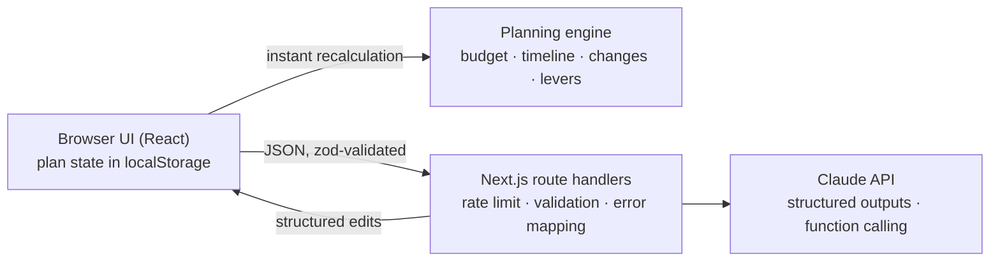

# ShaadiSaathi: a GenAI wedding planning assistant

[](https://github.com/apoorvgpt9/shaadi-saathi/actions/workflows/ci.yml)

ShaadiSaathi helps an Indian family organise their wedding: the **budget**, the **timeline**, **vendor checklists** and **personalized ideas** for every function (haldi, mehendi, sangeet, wedding, reception). It is built for execution, not inspiration. It asks before it assumes, shows the consequences of every decision, is honest about which numbers are estimates, and revises the plan when life changes.

**Live demo:** <https://shaadi-saathi-omega.vercel.app>

**Demo video (2:40):** <https://youtu.be/2veA-6XN5CU>

## Review guide

| Pillar | What is in place | Evidence |
|---|---|---|
| **Code quality** | A pure planning engine behind one zod contract. The layering rule is enforced by lint, not by convention. Strict TypeScript and ESLint, no suppressions, no type assertions other than `as const`, a one-line header on every source file, and the AI layer split by responsibility. | [`eslint.config.mjs`](eslint.config.mjs), [`src/lib/schemas/`](src/lib/schemas), [`src/lib/ai/`](src/lib/ai), [details](docs/EVALUATION.md#code-quality) |
| **Security** | The API key is read only on the server. Every request body is validated and size-capped. AI routes are rate limited per client. Model output is re-validated before use, and user text reaches the model as tagged, untrusted data. Security headers on every response. | [`src/lib/ai/route.ts`](src/lib/ai/route.ts), [`src/lib/ai/rate-limit.ts`](src/lib/ai/rate-limit.ts), [`next.config.ts`](next.config.ts), [`SECURITY.md`](SECURITY.md), [details](docs/EVALUATION.md#security) |
| **Efficiency** | The engine runs in the browser with no network. One Claude request per action. Effort and model are set per route. The first screen is prerendered HTML. Five runtime dependencies. | [`src/lib/ai/client.ts`](src/lib/ai/client.ts), [`package.json`](package.json), [details](docs/EVALUATION.md#efficiency) |
| **Testing** | 296 tests in two Vitest projects, with no network calls. Coverage is gated. The engine has a table-driven scenario spec. Components are tested with axe. | [`vitest.config.ts`](vitest.config.ts), [`tests/scenarios.test.ts`](tests/scenarios.test.ts), [`docs/TESTING.md`](docs/TESTING.md), [details](docs/EVALUATION.md#testing) |
| **Accessibility** | WAI-ARIA tabs, a native modal dialog with focus handling, live regions, labelled controls, status written in text, documented contrast ratios. `jsx-a11y` in lint and axe in the component tests. | [`docs/ACCESSIBILITY.md`](docs/ACCESSIBILITY.md), [`src/components/ui/Tabs.tsx`](src/components/ui/Tabs.tsx), [details](docs/EVALUATION.md#accessibility) |
| **Problem alignment** | Budgets, timelines, vendor checklists and personalized ideas each have a tab, an engine module or a route, and tests. | [mapping](docs/EVALUATION.md#problem-alignment) |

### Start here: 5 files

1. [`src/lib/ai/route.ts`](src/lib/ai/route.ts): `handleAi`, the one handler behind every AI route (rate limit, validation, error mapping, logging).
2. [`src/lib/plan/budget.ts`](src/lib/plan/budget.ts): `computeBudget`, where every rupee is derived, with its basis. The style of the whole engine.
3. [`src/app/api/change/route.ts`](src/app/api/change/route.ts): a route in full. It turns Claude's tool calls (built in [`tools.ts`](src/lib/ai/tools.ts)) into validated plan changes and drops any that do not fit the contract.
4. [`src/lib/store.ts`](src/lib/store.ts): the reducer, with `propose` and `accept`: a change is a function of the plan, re-applied on Accept.
5. [`src/components/PlanScreen.tsx`](src/components/PlanScreen.tsx): where the engine, the AI routes and the store meet the UI.

## The problem

Planning a wedding is not one problem. It is many connected ones. When the guest count changes, catering changes. When the date moves, the bookings that depend on it get urgent. When the budget shrinks, the family has to decide what matters most. A generic chatbot can list "10 wedding ideas", but it cannot keep a real plan consistent with a family's budget, deadlines and priorities.

ShaadiSaathi keeps that plan, and uses GenAI where it adds real value: understanding the family, turning plain-language changes into structured edits, personalizing ideas and checklists, and reading vendor quotes.

## What it does

| Need | How ShaadiSaathi handles it |
|---|---|
| **Understand the family first** | A short conversation (English or Hinglish) asks 1–2 questions at a time. A live "What I've understood" panel shows the date, city, guests, budget, functions, priorities and notes as they are captured. Nothing is planned until the essentials are known. |
| **Budget** | Each category (venue, catering, decor, photography, attire, makeup, entertainment, rituals, invitations, transport, contingency) is estimated bottom-up from guests per function, city tier and style. Every line shows its basis and an **Estimate / Quoted / Confirmed** badge. You can override any line, and the totals update instantly. |
| **Timeline** | 27 planning tasks with lead times and dependencies, scheduled back from each function's date. Overdue tasks, including delayed ones whose new date has passed, become **Urgent, this week**. Delaying a task pushes its dependents and flags them **At risk**, or **Clash** if they run into the function. "Next 3 things to do" always shows what is actionable now. |
| **Vendor checklists** | A personalized checklist per vendor category: what you need, questions to ask, and what to confirm before paying an advance. **Paste a quote** and the AI extracts the total, guests covered, inclusions, extra charges and open questions. Then **compare quotes** side by side against the budget estimate. |
| **Personalized ideas** | Three ideas per function, each marked as saving money, staying within budget or adding cost, and tied to *this* family (ages, culture, accessibility, priorities). Feedback such as "too expensive" or "suitable for kids and elders" regenerates them. |
| **Adapting to change** | Type "50 more guests, budget is now 7 lakh, wedding two weeks earlier". The AI turns it into structured changes with function calling, the plan is recomputed, and a **What changed** summary shows the money and task impact. Then you choose **Accept** or **Undo**. |
| **Trade-offs, not blanket cuts** | When over budget, the app computes concrete levers (trim a function's guests, step one category down, skip a minor function) with exact savings. The AI proposes up to three bundles that protect the family's top priorities. Nothing changes until the family picks one. |

## How GenAI is used, and where it is deliberately not

All money and dates are computed by a **deterministic, tested planning engine** (`src/lib/plan/`). Claude never produces a rupee amount used in calculations. Its only job with numbers is reading them from a quote the user pasted. This keeps estimates honest and the plan consistent.

| Route | What Claude does | Technique |
|---|---|---|
| `POST /api/intake` | Runs the conversation and extracts a structured profile every turn | Structured output (zod schema) |
| `POST /api/change` | Turns a plain-language change into plan edits, or asks one clarifying question | **Function calling**: 10 strict tools, one per edit type |
| `POST /api/tradeoffs` | Chooses and explains trade-off bundles from engine-computed levers | Structured output, ids validated against the engine |
| `POST /api/vendors` | Writes vendor checklists for this family | Structured output |
| `POST /api/ideas` | Writes ideas per function, and refines them from feedback | Structured output |
| `POST /api/quote` | Extracts facts from a pasted vendor quote | Structured output, with the quote treated as untrusted data |

Each route sends one Claude request: adaptive thinking, effort tuned per route, and server-side refusal fallback. Every response is re-validated with zod before it reaches the browser. The structured-output routes repeat the request once, only when the output is malformed, and invalid tool calls from `/api/change` are dropped. The model is configurable per route through environment variables.

## Architecture



- **The engine runs in the browser**, so budget edits, task updates and "what if" checks are instant and work even when the AI is unavailable.
- **AI routes are stateless.** The client sends only what each call needs, and the server stores nothing.
- **One shared contract:** [`src/lib/schemas/`](src/lib/schemas) defines every stored and transported shape once, as zod schemas. See [docs/ARCHITECTURE.md](docs/ARCHITECTURE.md) for the layers, algorithms and the AI request lifecycle.

### Where things are

```
src/lib/schemas/        the shared zod contract, re-exported by src/lib/types.ts
  limits.ts             every size limit, as one constant
  domain.ts             enums, the validated Profile, the intake draft
  plan.ts               the persisted Plan, vendor and idea payloads, PlanChange edits
  views.ts              derived view types the engine returns (never stored)
  api.ts                request and response shapes of the AI routes
  zod.ts                configures zod once (jitless, for the CSP)
src/lib/plan/           the deterministic planning engine (pure; no React, I/O or clock)
  benchmarks.ts         cost assumptions and display labels, in one place
  budget.ts             computeBudget: per-category estimates overlaid with quotes and overrides
  timeline.ts           27 task templates scheduled back from each function date, with flags
  changes.ts            applies the AI's structured edits to a plan, validating each result
  levers.ts             concrete savings, each priced by recomputing the budget
  options.ts            checks the AI's trade-off bundles against the levers
  summary.ts            diffs two plans into a "what changed" summary
  profile.ts            turns the intake draft into a Profile and a fresh Plan
  edits.ts              small pure plan edits used by the UI
src/lib/format.ts       rupee, date and plural formatting; UTC date maths
src/lib/store.ts        the reducer, pending changes, validated localStorage parsing
src/lib/api.ts          the browser's typed client for the AI routes
src/lib/ai/             server only
  route.ts              handleAi: the shared handler for every AI route
  errors.ts             error types and the mapping from any error to an HTTP failure
  rate-limit.ts         sliding-window limiter with an injected clock
  client-ip.ts          identifies the caller from proxy headers
  logger.ts             the one place that writes a log line
  client.ts             the only code that talks to Claude: models, effort, retry, usage
  prompts.ts            every system prompt and user-turn builder
  tools.ts              Claude tool definitions built from the PlanChange schema
src/app/api/            thin route handlers: pick schemas, a prompt and one Claude call
  intake/ change/ tradeoffs/ vendors/ ideas/ quote/   one route.ts each
  health/route.ts       liveness probe
src/app/                page, layout, error and not-found screens
src/components/         UI: App (client root), PlanScreen, Workspace, IntakeScreen, the four tabs
                        (Budget, Timeline, Vendors, Ideas), ChangeBox and ChangeSummaryPanel,
                        TradeoffPanel, profile panels, usePlan; ui/ holds the shared primitives
tests/                  engine, route, store and API tests (node); tests/ui/ for components (jsdom)
docs/                   ARCHITECTURE, EVALUATION, TESTING, ACCESSIBILITY, CHANGELOG
scripts/smoke.mjs       optional real-API check of every route against a running server
```

## Try it

Press **Try an example** on the first screen. It sends an example scenario as a real message: a Jaipur wedding about four months away, 200 guests, ₹8 lakh, with a mehendi the day before. Then:

1. **Build my plan.** The estimate comes to about ₹9.6L, roughly 20% over, and the urgent bookings are flagged.
2. In **What changed?**, type: *50 more guests, budget down to 7 lakh, wedding two weeks earlier*. Review the summary, then Accept.
3. **Help me get back under budget.** Pick one of the options and see the engine-computed saving.
4. **Vendors:** paste a caterer's quote and compare it against the estimate.
5. **Timeline:** mark "Shortlist and book venue(s)" as delayed and watch its dependents get flagged.

## Running locally

Requires Node.js 20 or newer (CI runs 22) and an Anthropic API key.

1. `npm install`
2. Create `.env.local` in the project root containing `ANTHROPIC_API_KEY=...` (your key). Every `.env*` file is gitignored.
3. `npm run dev`, then open <http://localhost:3000>.

| Variable | Purpose |
|---|---|
| `ANTHROPIC_API_KEY` | Required. Server-side only. |
| `ANTHROPIC_MODEL` | Default model for every route. Falls back to `claude-opus-5-5`. The hosted app sets `claude-sonnet-5-5`. |
| `ANTHROPIC_MODEL_<ROUTE>` | Per-route override: `INTAKE`, `CHANGE`, `QUOTE`, `VENDORS`, `IDEAS` or `TRADEOFFS`. The hosted app sets `ANTHROPIC_MODEL_CHANGE` and `ANTHROPIC_MODEL_TRADEOFFS` to `claude-opus-5-5`. |

```bash
npm test                                       # all tests; no network, Claude is mocked
npm run check                                  # format, lint, typecheck, tests with coverage
npm run build
node scripts/smoke.mjs http://localhost:3000   # optional: real calls to every route
```

## Quality gates

`npm run check` runs the first four rows in order. CI runs it, then the build and the audit. See [docs/TESTING.md](docs/TESTING.md) and [CONTRIBUTING.md](CONTRIBUTING.md).

| Command | What it enforces | Threshold or flag |
|---|---|---|
| `npm run format:check` | Prettier over `src`, `tests`, `scripts` and root `*.ts`/`*.mjs` | print width 100 |
| `npm run lint` | typescript-eslint `strictTypeChecked` and `stylisticTypeChecked`, `jsx-a11y`, `react-hooks`, Next.js core web vitals, and the layering rule: the engine and the server-side AI layer may not import each other, the UI, the store or the browser API client (`no-restricted-imports`) | any finding fails |
| `npm run typecheck` | `next typegen && tsc --noEmit` | `strict`, `noUncheckedIndexedAccess`, `noUnusedLocals`, `noUnusedParameters`, `noImplicitReturns`, `noFallthroughCasesInSwitch` |
| `npm run test:coverage` | Vitest over `src/**` (node and jsdom projects, axe in the UI suite) | statements 99%, branches 96%, functions 99%, lines 99% |
| `npm run build` | Production build | build errors fail |
| `npm audit --omit=dev --audit-level=high` | Known vulnerabilities in runtime dependencies | high or critical fails |

## What is verified, and what is not

| Check | Status | Notes |
|---|---|---|
| Unit and component tests, strict lint, typecheck, format, coverage gate, build, dependency audit | Run in CI on pushes to `main` and on pull requests | [`.github/workflows/ci.yml`](.github/workflows/ci.yml) |
| axe accessibility checks inside the component tests | Run in CI with the tests above | jsdom has no layout, so the colour-contrast rule is off there |
| Real-AI end-to-end run of the "Try it" scenario | Done by hand | Chromium only, against the deployed app |
| axe-core on every screen | Done by hand | Chromium only, against the deployed app |
| Lighthouse, mobile and desktop | Done by hand | Chromium only, against the deployed app; no scores are recorded in this repository |
| `scripts/smoke.mjs` (one real call per route) | Available, run by hand | Needs a running server and a key |
| Screen-reader testing (NVDA, VoiceOver) | Not done | Live-region wording and announcement order are untested |
| Browsers other than Chromium | Not done | |
| Load testing | Not done | |
| A rate limit shared across server instances | Not built | Counts are per instance; see [SECURITY.md](SECURITY.md) |
| Quality of the AI's advice | Not tested | The suites check shapes, validation and error handling |

## Honest limits

- Cost benchmarks are labelled assumptions by city tier and style, not vendor prices. Quotes you paste replace them.
- There is no live vendor search or availability. The app never claims a vendor is available or a price is confirmed.
- Plans are saved only in your browser (no account), so they don't sync across devices.

## License

[MIT](LICENSE)
