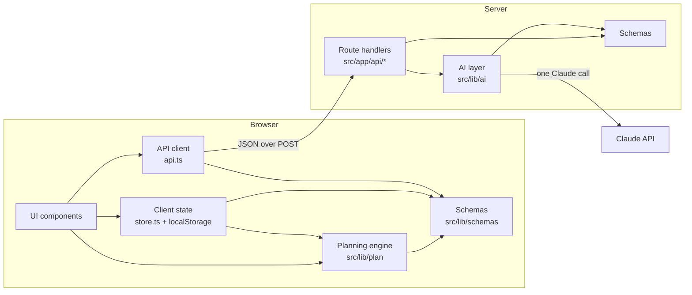

# Architecture

ShaadiSaathi keeps a wedding plan consistent with a family's budget, dates and priorities. A deterministic planning engine computes every rupee and every date in the browser; Claude is used only at the edges, to understand text and to propose structured edits that the engine then validates and prices.

## Layers

| Layer | Folder | Responsibility | Depends on |
|---|---|---|---|
| Schemas | `src/lib/schemas/` (barrel: `src/lib/types.ts`) | The shared contract: size limits, enums, the persisted `Plan`, derived view types, AI request and response shapes. Defined once as zod schemas. | `zod` |
| Planning engine | `src/lib/plan/`, `src/lib/format.ts` | Pure functions: budget, schedule, change application, levers, change summary, intake-to-plan. | Schemas |
| Client state | `src/lib/store.ts`, `src/components/usePlan.ts` | A reducer for the whole app, the `Pending` change awaiting review, validated localStorage parsing. | Schemas, engine (`summarizeChange`) |
| API client | `src/lib/api.ts` | One typed caller per AI route. Never throws; every failure becomes `{ ok: false }`. Validates each reply. | Schemas |
| UI | `src/components/`, `src/app/` (pages, layout, error and not-found) | Intake chat, workspace, tabs, review dialog. Renders state and calls the engine directly for instant recalculation. | Client state, engine, API client, Schemas |
| Route handlers | `src/app/api/*/route.ts` | One file per route: pick the schemas, the prompt and the Claude call. Stateless. | AI layer, Schemas |
| AI layer | `src/lib/ai/` | `route.ts`: the shared handler. `client.ts`: the only code that talks to Claude. `prompts.ts`, `tools.ts`: prompts and tool definitions. | Schemas, `@anthropic-ai/sdk` |
| Claude API | external | Structured output and function calling. | n/a |

## The dependency rule

The engine imports only schemas and its own modules. It has no React, no AI layer, no I/O, and no clock: "today" is a parameter (`scheduleTasks(plan, today)`, `summarizeChange(before, after, today)`). The AI layer and route handlers never import the engine, and routes keep no state. Dependencies point downwards in the table and nothing imports upwards.

Checked at the current commit with grep:

- `grep -rhn 'from "' src/lib/plan src/lib/format.ts` lists only `@/lib/types`, `@/lib/format` and `@/lib/plan/*` imports.
- `grep -rnE "react|next/|@/lib/ai|@/lib/api|@/lib/store|fetch\(|localStorage|Date\.now|process\.env|console\." src/lib/plan src/lib/format.ts` finds nothing. The only `new Date(...)` calls are in `format.ts` and always receive an explicit argument (ISO date arithmetic), never the current time.
- `grep -rn "@/lib/plan\|@/lib/store\|@/lib/api\|components" src/lib/ai src/app/api` finds nothing.
- `src/lib/store.ts` imports React as a type only (`import type { Dispatch }`).

The rule is not enforced by a lint rule or test; it is a convention that the grep above lets you re-check. Pure engine behaviour is covered by the unit tests (see [TESTING.md](TESTING.md)).

## Algorithms

| Problem | Approach | Where |
|---|---|---|
| Budget estimation | Bottom-up per category: a benchmark rate for the effective style (a per-category override wins over the profile style), multiplied by the city-tier factor where the category varies by city, then by guests, per-function weights (for example a haldi menu counts 0.5 of a wedding menu) or a flat/per-function model. Every line is rounded to the nearest ₹1,000; contingency is 7% of the other lines. A quote, a user override or a confirmation replaces the benchmark and changes the line's status (Estimate, Quoted, Confirmed). | `src/lib/plan/budget.ts`, `benchmarks.ts` |
| Dependency-ordered scheduling | 27 task templates listed in dependency order. Each is dated at its anchor function minus a lead time. Overdue open tasks are urgent, ranked earliest-ideal first and staggered: two per day starting today, capped at six days out. If an unfinished prerequisite is due on or after a task's own date, the task moves to the day after the latest such prerequisite (delay propagation); it is At risk when one of those prerequisites was delayed or is itself at risk, and Clash when it falls on or after its function. | `src/lib/plan/timeline.ts` |
| Change application | Each structured `PlanChange` is applied in order to a copy of the plan, and the result is re-validated against the `Plan` schema. A change that does not fit or would break the schema is skipped and reported in `ignored`; the function never throws. | `src/lib/plan/changes.ts` |
| Savings levers | Candidate edits (trim a function's guests by 20%, trim every list by 10%, step a category down one style, skip an optional function) are each priced by applying them and re-running the budget engine. Levers that save nothing are dropped and the rest are sorted by saving. | `src/lib/plan/levers.ts` |
| Change summary | Diff of two plans: changed budget lines, totals before and after, tasks newly urgent, at risk or clashing (by id, comparing both schedules), and follow-up notes. | `src/lib/plan/summary.ts` |
| Proposals rebased on Accept | A proposal is a pure function of the plan (`Proposal`), not a snapshot. It is evaluated once to show the review and again on Accept against the plan as it is by then, so edits made in between survive. | `src/lib/store.ts` (`propose`, `accept`) |
| Trade-off options | The AI chooses bundles of lever ids. Unknown ids are dropped, an option with no ids is dropped, and the saving and percent of budget shown are recomputed by the engine. | `src/lib/plan/options.ts` |

## AI request lifecycle

Every AI route runs through `handleAi` in `src/lib/ai/route.ts`:

1. **Rate limit.** 40 requests per client IP per 10 minutes, in instance memory, keyed on `x-real-ip`, then the first `x-forwarded-for` entry. Over the limit: 429.
2. **Body cap.** A declared `content-length` over 100,000 is refused before reading; a chunked body is checked after reading. Oversize or unparseable JSON is treated as invalid input.
3. **Request validation.** The route's zod request schema. Failure: 400. The intake route additionally rejects a conversation that ends on an assistant turn (400).
4. **One Claude call.** `generate` (structured output validated by zod; it repeats once only if the output fails to parse) for intake, ideas, vendors, quote and tradeoffs, or `callTools` (function calling with `tool_choice: auto`, one strict tool per `PlanChange` variant) for change. Adaptive thinking is on; server-side refusal fallback is on for every model except Haiku. Each attempt has a 100 second timeout with SDK retries off, inside the routes' `maxDuration` of 300 seconds.
5. **Response validation.** The route post-processes the result (for change, tool calls that fail `PlanChange` are dropped; for quote, a missing total is an error), then the response zod schema is applied. Failure: 502.
6. **Error mapping.** A refusal is 422. Auth, permission, payment, rate-limit and overload errors from Anthropic, connection failures and exhausted credit are 503. Anything else, including malformed output and unexpected exceptions, is 502. SDK error text is never passed to the user. The handler has no path that returns 500.
7. **Structured log.** One JSON line per request: route, status, milliseconds, model and token counts. User content is never logged.

Model and effort per route, from `src/lib/ai/client.ts`:

| Route | Call | Effort | Max output tokens |
|---|---|---|---|
| `intake` | `generate` | low | 8,000 |
| `change` | `callTools` | medium | 8,000 |
| `quote` | `generate` | low | 8,000 |
| `vendors` | `generate` | medium | 16,000 |
| `ideas` | `generate` | medium | 16,000 |
| `tradeoffs` | `generate` | medium | 8,000 |

The model for a route is `ANTHROPIC_MODEL_<ROUTE>`, else `ANTHROPIC_MODEL`, else `claude-opus-5-5` (`modelFor`). The hosted deployment sets Sonnet as the default with Opus for `change` and `tradeoffs`, as noted in `.env.example`.

## State lifecycle

- **Server-rendered intake.** The server and the first client render both use `initialState`, so the first screen is real HTML. `npm run build` lists `/` as static (prerendered), and the generated `index.html` contains the intake screen's text.
- **Hydrate after mount.** `usePlan` reads localStorage in an effect (`parseStored`, key `shaadi-saathi:v1`) and dispatches `hydrate`. Corrupt, partial or incompatible data parses to `null` and is ignored. A save effect is declared before it and skipped until hydration has run, so the saved state is never overwritten by the empty one.
- **What persists.** `stage`, `messages`, `draft` and `plan`. A pending change is in memory only; a reload discards it.
- **Propose, review, accept.** A change request or a chosen trade-off calls `propose(build, today)`. The reducer computes the result and a `ChangeSummary` from the current plan and holds them as `pending`. The dialog shows them; Accept re-applies `build` to the current plan, Undo discards.
- **Start over.** `cancelRequests()` aborts every in-flight call so a late answer cannot land on the next plan, then the reducer returns to `initialState`.

## Decisions

- **Deterministic core, AI at the edges.** Money and dates come from tested pure functions; Claude never sets a rupee amount used in a calculation, and its edits go through the engine. Why: estimates stay explainable and consistent, and the budget and timeline still work when the AI is down.
- **The engine runs in the browser.** Why: edits and what-if checks are instant and need no network.
- **Stateless routes, browser storage.** Why: no accounts, no database, nothing of the user's stored on the server, and the routes scale as plain functions. Cost: plans do not sync across devices, and the rate limiter is per instance.
- **One shared handler for all AI routes.** Why: rate limiting, validation, error mapping and logging are written once; a route file only supplies schemas and a Claude call.
- **Strict tools, one per edit type.** Why: the model's output is checked against the same `PlanChange` schema the engine uses, and an invalid call is dropped instead of applied.
- **Per-route model and effort.** Effort is fixed per route in code; the model is an environment variable per route. Why: cost and latency differ by task, so the hosted app runs a cheaper model for conversational routes and a stronger one where an edit must be exact. The model comparison that informed this lives outside the repository.
- **Proposals are functions, rebased on Accept.** Why: vendors, ideas and edits that land while the dialog is open are not lost.
- **Server-rendered first screen.** Why: the intake screen is meaningful HTML before JavaScript runs, and saved state is applied after mount so server and client markup match.
- **Native `<dialog>` for the review.** Why: the browser provides the inert background, focus containment and Escape handling; the component only adds focus return and a Tab wrap for browsers that let Tab leave the dialog.
- **One `tbody` per quote.** Why: a quote's open questions sit in a full-width row under it, which a single shared body cannot group.
- **zod everywhere a boundary is crossed.** Why: localStorage, request bodies, model output and API replies are all untrusted; one schema set serves the engine, routes and client. `schemas/zod.ts` switches zod to JIT-less mode once, as a side-effect import the `@/lib/types` barrel loads first, because the Content-Security-Policy forbids the `Function` constructor that zod's JIT probe uses. Schema files import `z` from `zod` directly so the bundler can tree-shake it.

See also [TESTING.md](TESTING.md), [ACCESSIBILITY.md](ACCESSIBILITY.md), [SECURITY.md](../SECURITY.md) and [CONTRIBUTING.md](../CONTRIBUTING.md).
